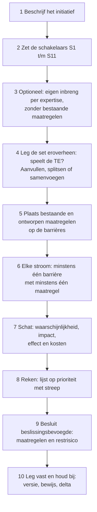
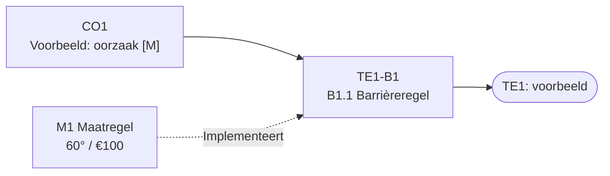
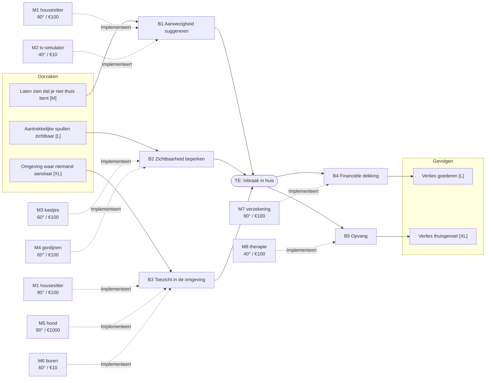
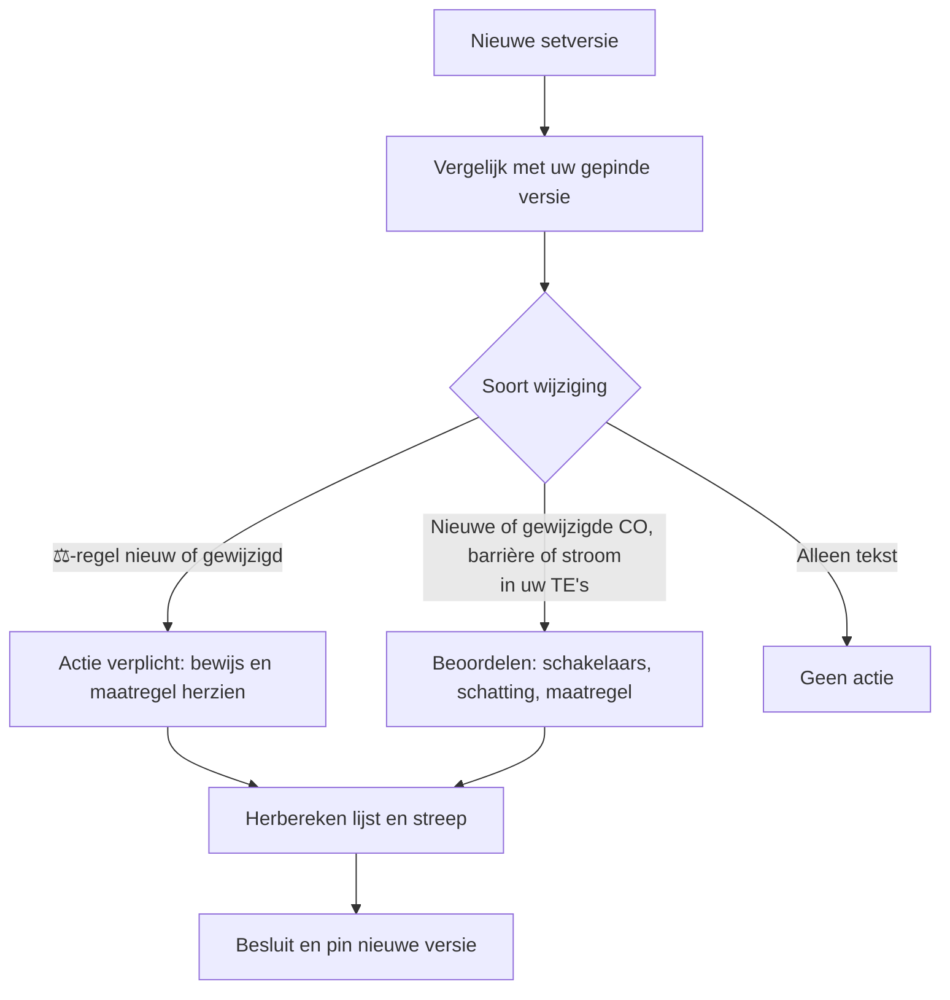

# Handleiding: Geintegreerde Workshop Risico AI-initiatieven analyseren met de generieke vlinderdassen

## waarom GWR
* gezamenlijk vocabulaire 
* herbruikbaar startpunt
* maakt de analyse gestructureerd en hwrbruikbaar
* maakte de redenering inspecteerbaar
* maakt heroverweging een normaal gevolg van voortschreidend inzicht
* kan aantal pagina' aan conpliance documentatie drastisch verlagen

## In het kort

- **Doel:** per AI-initiatief alle relevante risico's, barrières en wettelijke verplichtingen doorlopen, maatregelen kiezen op kosteneffectiviteit en het restrisico expliciet laten accepteren.
- **Wat u krijgt:** een vaste set van 23 vlinderdassen (de *set*) met oorzaken, gevolgen en barrières. U voegt schattingen en eigen maatregelen toe.
- **Uitkomst:** een lijst van maatregelen op prioriteit met een harde streep. Erboven doen we, eronder niet. Wat onder de streep valt, is geaccepteerd restrisico.
- **Wettelijk verplichte barrières (⚖)** vallen buiten de kostenafweging. Hun maatregelen staan altijd boven de streep.
- **Schakelaars** bepalen hoe zwaar u iets weegt, niet of u ernaar kijkt.
- **Nieuwe versie van de set?** U loopt het verschil door en herziet uw analyse zelf. Zo blijven risico-inzicht en maatregelen sluitend.

## 1. Het proces

Doe stap 3 vóór stap 4: zo vindt u risico's die de set niet kent. Doe stap 5 vóór stap 6: wat al is ontworpen, hoeft niet opnieuw bedacht. Consensus bij het schatten is wenselijk maar niet nodig; bij twijfel geldt de ongunstigste schatting.

## 2. Schakelaars

De definities staan in de set. Per schakelaar kiest u ja of nee voor het hele initiatief.

| Stand | Wat u doet |
|---|---|
| **Ja** | Alle gemarkeerde regels en COs volledig uitwerken: schatten, maatregelen, bewijs. |
| **Nee** | Eén regel vastleggen: "S# nee, omdat …". De gemarkeerde stroom schat u grof en u ontwerpt er geen maatregelen voor, tenzij een ander ⚖-regel dat vraagt. |
| **Twijfel** | Ja. |

S5, S8 en S9 schakelen een hele TE in of uit (TE22, TE4, TE20). Overige schakelaars wegen alleen de gemarkeerde regels. Het blijft verstandig alle TE's minstens te scannen: een verkeerd beantwoorde schakelaar ziet u zo vroeg. De set modelleert toegestane toepassingen; bij twijfel of een toepassing (deels) verboden is, eerst juridisch advies.

## 3. Conventies en legenda

| Weergave | Betekenis |
|---|---|
| Rood, ronde hoeken | Top Event (TE) |
| Rood gestippeld, `TE9` | Verwijzing naar een andere TE als oorzaak of gevolg |
| Wit | Causaal object (CO): oorzaak links van de TE, gevolg rechts |
| Groen | Barrière |
| Blauw, ⚖ | Barrière met minstens één wettelijk verplichte regel |
| Blauw gestippeld, ⚖? | Barrière op basis van voorstelwetgeving |
| `[S#]` | Schakelaar die de regel of CO aan- of uitzet |

| Code | Betekenis | Voorbeeld |
|---|---|---|
| `TE9` | Top Event | TE9 |
| `CO57` | Causaal object, doorlopend genummerd over alle TE's. Dezelfde CO kan in meerdere TE's voorkomen, als oorzaak in de ene en gevolg in de andere. | CO57 |
| `TE9-B3` | Barrière op één stroom binnen TE9. Een barrière staat aan één kant van de TE. | TE9-B3 |
| `B3.2` | Eén regel in die barrière: afzonderlijk te noemen, te implementeren en te taggen met ⚖. Volledig: `TE9-B3.2`. | TE9-B3.2 |
| `M12` | Maatregel van uw organisatie, geen onderdeel van de set. | M12 |

Nummers veranderen nooit en worden nooit hergebruikt; vervallen items krijgen status *retired*. Verwijs altijd met setversie en nummer.

**Maatregelen toevoegen:** teken een maatregelnode met temperatuur en kosten en verbind die met een gestippelde pijl "Implementeert" naar de barrière. Dezelfde maatregel mag op meerdere barrières met eigen temperatuur en kosten.

## 4. Schatten

Alles in ordes van grootte; Fibonacci-achtige schalen werken omdat we onder onzekerheid schatten.

| Wat | Schaal | Waarde |
|---|---|---|
| Waarschijnlijkheid van een CO (oorzaak) en impact van een CO (gevolg) | T-shirtmaat | XS 2, S 3, M 5, L 8, XL 13 |
| Werking van een maatregel | Wastemperatuur | 40° = 1 maat lager, 60° = 2, 90° = 3; nooit lager dan XS |
| Last van een maatregel (investering en nadeel voor het systeem) | Euro, ordegrootte | €10, €100 of €1.000 |

- **Impact:** de zwaarst geraakte stakeholder bepaalt de maat.
- **Kosten:** tellen per maatregel één keer, de hoogste over alle stromen waar hij werkt. Ze tellen niet op.
- **Onzeker?** Markeer de schatting met `?` en reken met −1 en +1 maat als bandbreedte; bij twijfel geldt de ongunstigste.
- **Per stroom:** geef elke oorzaak en elk gevolg een eigen maat, niet de TE als geheel.

## 5. Rekenen en de streep

**Regels**

1. **Waarde per CO** = maat, verlaagd met de som van de stappen van alle maatregelen in die stroom (ondergrens XS).
2. **Gatenkaasbonus:** zitten er *n* ≥ 2 maatregelen in dezelfde stroom, trek dan *n* − 1 punt af van die CO, met een ondergrens van 1.
3. **Risico van een TE** = (som van de waarden van alle oorzaken) × (som van de waarden van alle gevolgen). Totaalrisico = som over alle TE's.
4. **Kiezen:** bereken per maatregel de reductie per euro, kies de beste, herbereken op de nieuwe stand, en herhaal. Zo vangt u afnemende meeropbrengsten af. Bij gelijke scores wint de goedkoopste of praktischste.
5. **Streep:** u trekt hem waar de extra reductie per euro niet meer opweegt, of waar het budget op is. De beslissingsbevoegde bepaalt de positie.
6. **⚖-maatregelen** staan boven de streep, ook als hun ratio laag is. Alleen een gedocumenteerde grond (schakelaar nee, of een andere route naar compliance) kan ze eronder zetten.

**Voorbeeld: inbraak in huis**

Zonder maatregelen is het risico (5 + 8 + 13) × (8 + 13) = 26 × 21 = 546. De selectie levert deze lijst:

| Rang | Maatregel | Risico na | Reductie | Kosten | Reductie/€ | Cumulatieve kosten |
|---|---|---|---|---|---|---|
| 1 | M6 buren | 378 | 168 | €10 | 16,8 | €10 |
| 2 | M2 tv-simulator | 336 | 42 | €10 | 4,2 | €20 |
| 3 | M1 housesitter | 210 | 126 | €100 | 1,26 | €120 |
| 4 | M3 kastjes | 105 | 105 | €100 | 1,05 | €220 |
| ━━ | **streep: restrisico 105 voor €220** | | | | | |
| 5 | M4 gordijnen | 63 | 42 | €100 | 0,42 | €320 |
| 6 | M7 verzekering | 48 | 15 | €100 | 0,15 | €420 |
| 7 | M8 therapie | 33 | 15 | €100 | 0,15 | €520 |
| 8 | M5 hond | 33 | 0 | €1.000 | 0,00 | €1.520 |

De hond voegt niets toe zodra de housesitter er is: een voorbeeld van afnemende meeropbrengst. Verschijnt dezelfde maatregel in andere TE's, dan telt zijn reductie daar mee en kan hij hoger komen.

**Uw lijst** heeft deze kolommen: rang, maatregel, implementeert (`TE#-B#`), ⚖ (ja/nee), reductie, kosten, reductie/€, eigenaar, besluit. Onder de streep staat per maatregel een onderbouwing van de acceptatie.

## 6. Vastleggen en bijhouden

**Wat u vastlegt:** setversie en datum, stand van de schakelaars, diagrammen met schattingen, maatregelenlijst met streep, acceptatiebesluit (wie, wanneer, onderbouwing onder de streep), per ⚖-regel een bewijsstuk, per maatregel een eigenaar met een handvat voor monitoring en detectie en een status: gepland, geïmplementeerd of geverifieerd. Het restrisico in uw rapportage rekent u op geverifieerde maatregelen; geplande toont u apart.

**Sluitend:**

1. Elke barrière binnen scope is geïmplementeerd (maatregel boven de streep) of gemotiveerd geaccepteerd (onder de streep).
2. Elke maatregel boven de streep implementeert minstens één barrière.
3. Elke ⚖-regel binnen scope heeft een bewijsstuk.
4. Elke maatregel heeft een eigenaar.

**Nieuwe versie van de set:**

Herzien doet u ook bij een wetswijziging, een incident met een vergelijkbaar systeem of een update van een hergebruikte vlinderdas. Toets daarnaast periodiek of maatregelen nog werken.

## 7. Wat de set wel en niet is

- **Wel:** een bijdrage aan volledigheid en een manier om risicoanalyse, compliance en toezicht sneller en herhaalbaar te maken. Doorgelicht op AVG, AI Act (deels), CRA, CADA (voorstel), OWASP (LLM en agentic), Cbw, Wwke, Woo, Archiefwet en Awb.
- **Niet:** een garantie op volledigheid, juridisch advies of een vervanging van de formele stukken in §8. DPIA, FRIA en vergelijkbare stukken blijven narratief; de set voedt ze.
- **Niet doorgelicht:** auteursrecht buiten generatieve AI, sectorwetgeving, Data Act. Verwacht daar lacunes.
- **Enkelvoudig:** elke TE staat op zichzelf. Interacties tussen TE's, trapsgewijze effecten en wederzijdse beïnvloeding bespreekt u los.
- **Buiten de set:** risico's die u mist legt u vast met de reden en meldt u aan de beheerder van de set. Ze worden in een volgende versie verwerkt.

## 8. Bewijsstukken en toezicht

De ingevulde set is de grondstof. Onderstaande stukken kunt u eruit voeden; één analyse hoeft niet tien keer te worden herschreven.

Vorm: 📝 vrij · 📋 inhoud voorgeschreven, vorm vrij · 🖥️ vast formulier of portaal · 📐 vast model. ⚠️ = actuele stand niet volledig bevestigd; controleer vóór gebruik.

**Eigen analyse** (basis: AI Act Art 9 [S8]; Cbw-zorgplicht met goedkeuring door het bestuur [S1]; AVG Art 24 en 32)

| Bewijsstuk | TE | Toezichthouder | Vorm |
|---|---|---|---|
| Risicomanagementdossier: ingevulde set, lijst met streep, acceptatiebesluit | alle | AP, markttoezichthouders (AI Act), RDI (Cbw) ⚠️ | 📋 |

**AVG** (toezichthouder: Autoriteit Persoonsgegevens)

| Bewijsstuk | TE | Toezichthouder | Vorm |
|---|---|---|---|
| DPIA en voorafgaande raadpleging (Art 35, 36) | 1, 3, 5, 9, 15, 16 | AP | 📋 (binnen het Rijk gangbaar: Model DPIA Rijksoverheid ⚠️) |
| Verwerkingsregister (Art 30) | 3, 15 | AP | 📋 |
| Verwerkers- en sub-verwerkersovereenkomsten (Art 28) | 3, 14 | AP | 📋 |
| Datalekregister en -melding (Art 33, 34) | 3, 9 | AP | 🖥️ melding, 📝 register |
| Doorgifte buiten de EER: modelbepalingen en transfer impact assessment (hoofdstuk V) | 3 | AP | 📐 modelbepalingen, 📝 assessment |

Let op: melding binnen 72 uur; kan samenvallen met Cbw- en CRA-melding.

**AI Act** (markttoezichthouders; Nederlandse uitvoeringswet nog niet in werking ⚠️)

| Bewijsstuk | TE | Toezichthouder | Vorm |
|---|---|---|---|
| FRIA, fundamentele-rechtenimpactassessment (Art 27) [S8] | 1, 4, 7, 11, 12, 16 | Markttoezichthouder ⚠️ | 📋, melding via sjabloon ⚠️ |
| Classificatiebesluit hoog risico (Art 6) [S8] | 4 | Markttoezichthouder | 📝 |
| Registratie EU-databank (Art 49, 71) [S8] | 4 | Commissie; toezicht markttoezichthouder | 🖥️ |
| Providerdossier: technische documentatie, conformiteitsverklaring, kwaliteitssysteem, logging, gebruiksaanwijzing, monitoringplan [S8] | 2, 4, 5, 6, 9, 18 | Markttoezichthouder | 📋, 📐 verklaring |
| Gebruikersdossier: gebruik volgens instructies, aangewezen toezicht, logs minstens 6 maanden, informeren betrokkenen (Art 26, 86) [S8] | 5, 6, 16, 18 | Markttoezichthouder | 📝 |
| Melding ernstig incident (Art 73) [S8] | 2, 4, 8, 22 | Markttoezichthouder | 🖥️ ⚠️ |
| Transparantiemaatregelen (Art 50) | 5, 20 | Markttoezichthouder ⚠️ | 📝 |
| Rolbepaling aanbieder of gebruiker (Art 25) [S11] | 10, 15 | Markttoezichthouder | 📝 |
| Bewijs AI-geletterdheid (Art 4) | 6, 17 | Markttoezichthouder ⚠️ | 📝 |

Let op: hoogrisico-eisen voor Annex III zijn volgens politiek akkoord uitgesteld tot 2-12-2027, controleer publicatie ⚠️. Art 50 geldt sinds 2-8-2026; markering voor bestaande systemen uiterlijk 2-12-2026. De Omnibus-versie van Art 4 kan afwijken ⚠️. Een melding van een ernstig incident kent korte termijnen (dagen).

**Cyberbeveiliging: Cbw, Wwke, CRA, CADA**

| Bewijsstuk | TE | Toezichthouder | Vorm |
|---|---|---|---|
| Cbw: registratie in het Nationaal Entiteitenregister [S1] | 9, 17, 19 | NCSC, RDI ⚠️ | 🖥️ |
| Cbw: zorgplichtdossier met risicoanalyse, maatregelen (BIO2), bestuursgoedkeuring en -training [S1] | 9, 14, 17, 19 | RDI ⚠️ | 📋 |
| Cbw: incidentmelding, 24u waarschuwing, 72u melding, eindrapport binnen een maand [S1] | 3, 9, 19, 22 | CSIRT (NCSC) en toezichthouder | 🖥️ |
| Wwke: risicobeoordeling en weerbaarheidsmaatregelen [S2] | 19 | Vakminister, sectoraal toezicht ⚠️ | 📋 ⚠️ |
| CRA: technische documentatie, conformiteitsverklaring, gebruiksinformatie, SBOM, kwetsbaarhedenbeleid [S3] | 9, 10 | RDI (markt), NCSC (CSIRT) ⚠️ | 📋, 📐 verklaring |
| CRA: melding actief misbruikte kwetsbaarheden en ernstige incidenten, 24u/72u [S3] | 9 | Via ENISA-meldplatform naar CSIRT | 🖥️ |
| CADA: risicobeoordeling en assurance-niveau [S4] | 9, 14 | Nog te bepalen | ⚠️ voorstel |

Let op: CRA-meldplichten gelden sinds 11-9-2026, de rest per 11-12-2027. Eén incident kan meerdere meldingen en ontvangers geven (AVG, Cbw, CRA).

**Overheidsinformatie**

| Bewijsstuk | TE | Toezichthouder | Vorm |
|---|---|---|---|
| Informatiebeheerdocumentatie: selectielijst, bewaartermijnen, metadata (Archiefwet) | 23 | Inspectie Overheidsinformatie en Erfgoed ⚠️ | 📋 ⚠️ |
| Woo-besluiten en lakdocumentatie | 23 | Bezwaar en bestuursrechter | 📝 |

**Overig**

| Bewijsstuk | TE | Toezichthouder | Vorm |
|---|---|---|---|
| Besluitmotivering en dossier (Awb) | 5, 6 | Bezwaar en bestuursrechter | 📋 |
| Toegankelijkheidsverklaring (Besluit digitale toegankelijkheid overheid) | 11 | Toezichthouder en register ⚠️ | 📐 |
| Instemming medezeggenschap (WOR of sectorale regeling) | 7, 10, 16 | Geen | 📝 |
| Inkoop- en contractdossier: AI-inkoopkader, exit en escrow, leveranciersverklaringen | 5, 10, 14 | Indirect via overige stukken | 📝 |

**Toezichthouders in het kort:** de AP voor AVG en naar verwachting veel AI Act-onderdelen; de RDI voor de Cbw (sector overheid), CRA en AI Act in kritieke digitale infrastructuur; het NCSC als CSIRT en voor het entiteitenregister; ENISA voor het CRA-meldplatform; de Commissie en het AI Office voor de EU-databank en sjablonen ⚠️.